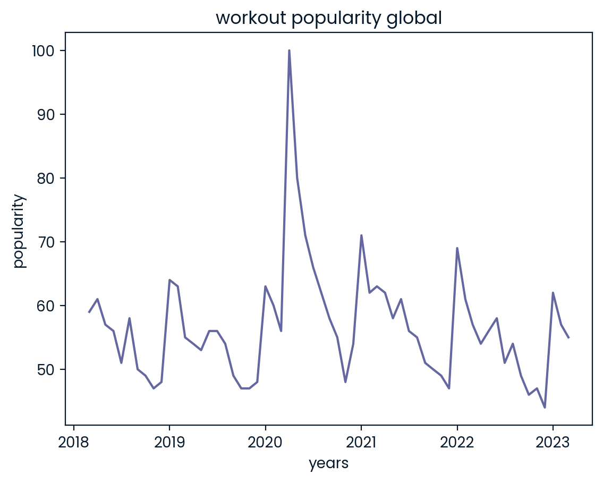
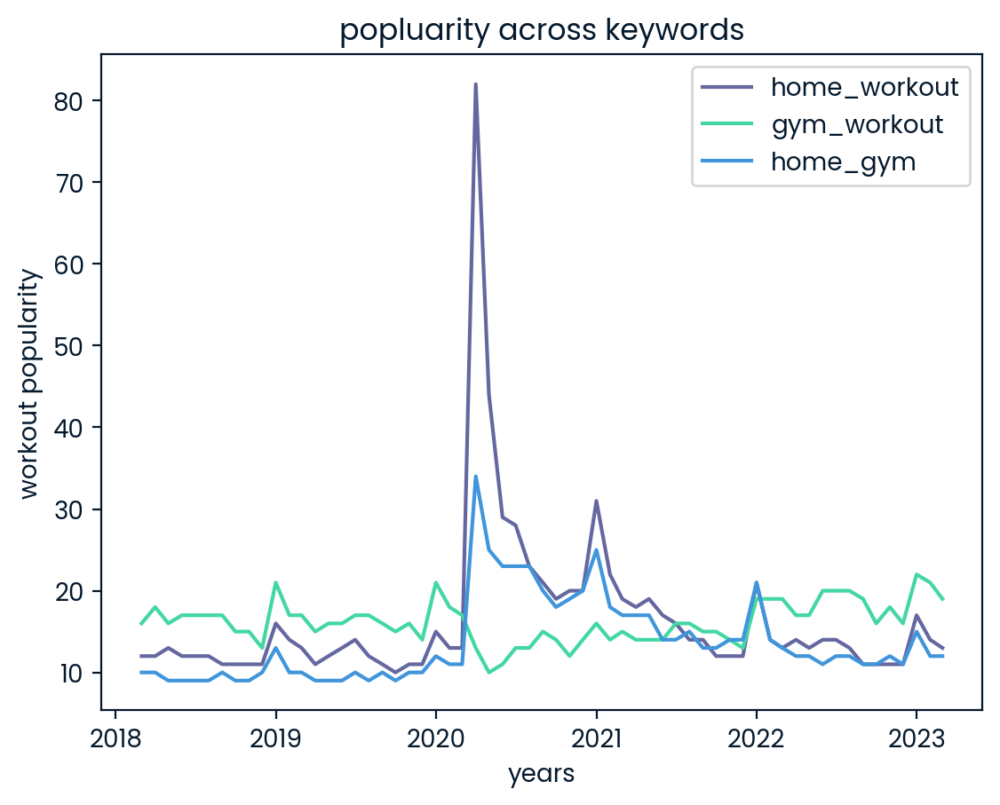

## Digital Fitness Demand: Market Analysis with Google Trends

Market analysis of Google Trends data (2018 to 2023) to gauge demand for digital fitness classes and find areas for growth. Completed as a guided DataCamp project using Python, pandas and matplotlib.

## Business Context

As a product manager at a fitness studio, the goal is to understand current demand for digital fitness products and decide where to focus growth. This project uses search interest for fitness-related keywords, worldwide and by country, as a proxy for demand.

## Dataset

Four CSV files of Google Trends indices (scaled 0 to 100, where 100 is peak popularity):

| File | Contents |
|---|---|
| `workout.csv` | Monthly worldwide popularity of the keyword "workout" |
| `three_keywords.csv` | Monthly worldwide popularity of "home workout", "gym workout" and "home gym" |
| `workout_geo.csv` | Country-level popularity of "workout" over 2018 to 2023 |
| `three_keywords_geo.csv` | Country-level popularity of "home workout", "gym workout" and "home gym" over 2018 to 2023 |

## Questions Answered

1. **When was global search interest in "workout" at its peak?**
   Converted `month` to a date, plotted the trend and used `idxmax()` to find the peak month.
   **Answer:** 2020 (`year_str = '2020'`).

   

2. **Which keyword was most popular during the COVID-19 pandemic, and which is most popular now?**
   Plotted all three keywords on one chart.
   **Answer:** "Home workout" spiked sharply in early 2020, reaching about 82 on the index, far above the other two keywords. "Gym workout" is the most popular keyword now, ahead of the other two in 2023.

   

3. **Which country has the highest interest in workouts among the United States, Australia and Japan?**
   Looked up each country's index in `workout_geo.csv`.
   **Answer:** United States (100), ahead of Australia (77) and Japan (1).

4. **Should the studio expand its virtual home workouts offering to the Philippines or Malaysia?**
   Filtered `three_keywords_geo.csv` to the two countries and sorted by `home_workout_2018_2023`.
   **Answer:** Philippines, which has the higher home workout interest of the two.

## Approach

- Loaded all four datasets with `pandas`
- Converted the `month` column to datetime for a readable time axis
- Plotted trends over time with `matplotlib` (single-series and multi-series line charts)
- Used `idxmax()` to locate peak values
- Filtered rows with `isin()` and ranked countries with `sort_values()`

## Key Takeaways

- Search interest in working out peaked in 2020, driven by the pandemic.
- Home workout interest surged during COVID but has fallen back, and gym workout interest now leads.
- Demand for digital home workouts is strongest in the Philippines of the two candidate markets.

## Tools

Python, pandas, matplotlib, Jupyter Notebook

## Repository Contents

- `notebook.ipynb`: full analysis with code and outputs
- `data/`: the four CSV files
- `images/`: charts used in this README

## How to Run

```bash
pip install pandas matplotlib jupyter
jupyter notebook
```

Open the notebook and run all cells. The CSV files must be in the `data/` folder.

## Author

Unnati Rai | [LinkedIn](https://www.linkedin.com/in/unnatirai/) | [GitHub](https://github.com/unnatirai21)
